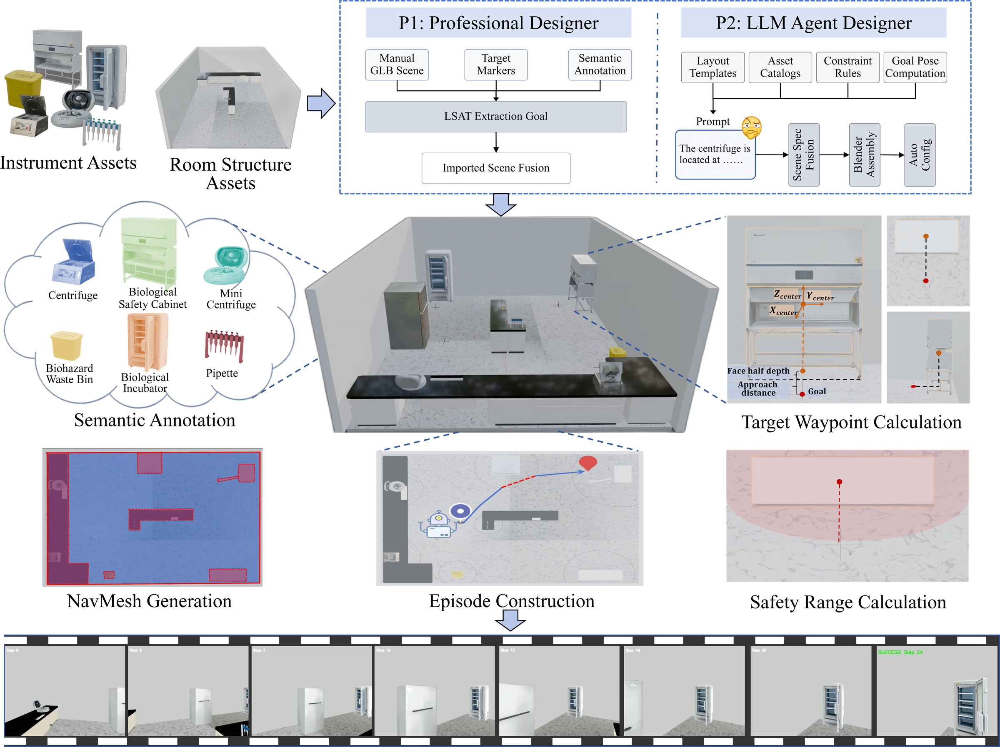
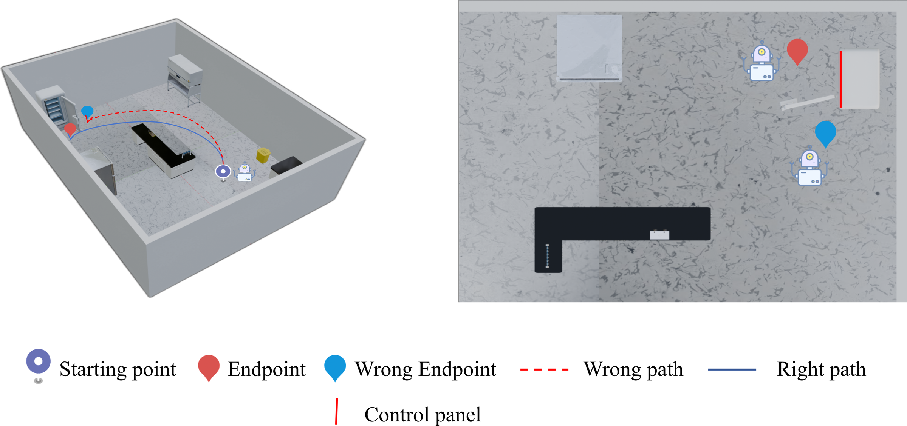

# BioVLN: A Simulation Platform for Visual Language Navigation in Biomedical Laboratories

BioVLN is a simulation platform for developing and evaluating visual-language navigation (VLN) agents in biomedical laboratories. It introduces a **three-zone operational envelope model** (body, clearance, operation area) that governs scene generation, navigation evaluation, and safety monitoring. The platform supports both **zero-shot benchmarking** (6 methods, 47 scenes, 1,667 episodes) and **learned policy training** via standard Gym/RL interfaces.



*Figure 1: BioVLN platform architecture. P1 (left): user-authored scene import (Path B). P2 (right): procedural generation (Path A). Both converge into a shared benchmark pipeline with six-method evaluation and safety metrics.*

---

### Key Features

- **Three-Zone Operational Envelope** — Zone 1 (physical bounding box), Zone 2 (0.25 m clearance margin), Zone 3 (operational envelope). Jointly governs scene generation, collision avoidance, and safety evaluation.
- **Dual-Entry Pipeline** — Path A: procedural generation from instrument catalogs + layout templates. Path B: user-authored GLB import via LSAT annotation toolkit.
- **Six Baseline Methods** — Random, Oracle, Frontier Exploration, LLM-Frontier, 3-Zone Oracle, VLFM (GPT-4o + Grounding DINO + SAM).
- **Safety Metrics** — MCR (Minimum Clearance Radius) and VRT (Violation Rate at Threshold), computed from the three-zone model.
- **Training Pipeline** — Trajectory recording, PyTorch Dataset, Gym environment, and unified interface for behavioral cloning and RL.

---

## Directory Structure

```
BioVLN/
├── platform/            # Scene generation core
│   ├── scene_generator.py     — Procedural spec generator
│   └── config.py              — Instrument catalog + layout templates
│
├── pipeline/            # Shared 3-step pipeline
│   ├── lab_builder_blender.py — Blender headless scene assembly
│   ├── auto_config.py         — Runtime config auto-generator
│   ├── step1_semantic.py      — Vertex-level COLOR_0 semantic annotation
│   ├── step2_navmesh.py       — Recast navigation mesh generation
│   ├── step3_episodes.py      — Episode construction (start + goal sampling)
│   ├── run_vlfm_v4.py         — VLFM agent (GPT-4o + GDINO + SAM)
│   ├── interactive_viewer.py  — Habitat-sim interactive scene viewer
│   ├── build_diverse.py       — Batch build orchestrator
│   ├── aggregate_splits.py    — Train/dev/val/test split builder
│   ├── generate_lab.py        — GLB post-processing
│   └── postprocess_episodes.py — Episode validation + cleanup
│
├── scripts/             # Evaluation runners
│   ├── biovln_eval.py         — ★ Standard evaluation SDK
│   ├── run_baselines.py       — Random + Oracle
│   ├── run_frontier.py        — Frontier Exploration (FBE)
│   ├── run_llm_frontier.py    — LLM-Frontier (DeepSeek-chat)
│   ├── run_three_zone.py      — 3-Zone Oracle
│   ├── run_vlfm_all.py        — VLFM multi-dataset runner
│   ├── run_vlfm_safety.py     — VLFM + safety tracking
│   ├── run_vlfm_viz_safety.py — VLFM trajectory visualization
│   ├── rerun_baselines_safety.py — Baseline safety re-runner
│   ├── run_ablation_centroid.py  — Centroid vs op-face ablation
│   ├── generate_templates_llm.py — LLM-assisted layout generation
│   └── render_instrument_closeups.py — Blender instrument renders
│
├── training/            # ★ Training pipeline (RL + behavioral cloning)
│   ├── biovln.py              — Unified interface: bench / record / make_env / evaluate_trained
│   ├── biovln_gym.py          — Gymnasium environment (compatible with SB3)
│   ├── data_recorder.py       — TrajectoryRecorder callback
│   └── trajectory_dataset.py  — PyTorch Dataset for recorded trajectories
│
├── lsat/                # LSAT Blender addon (13 modules, ~2,500 lines)
│   ├── glb_pipeline.py        — ★ Dual-strategy goal extraction (Strategy 1: target_* nodes, Strategy 2: centroid + op-face)
│   ├── scanner.py             — GLB/GLTF mesh traversal
│   ├── generator.py           — Procedural layout generation
│   ├── semantics.py           — Semantic region annotation
│   ├── collision.py           — Collision detection (Zone 2 overlap check)
│   ├── operators.py           — Blender operator registration
│   ├── panel.py               — Blender UI panel
│   ├── properties.py          — Property definitions
│   ├── graph.py               — Scene graph utilities
│   ├── exporter.py            — Multi-format export (BioVLN JSON, LSAT internal, Isaac Sim USD)
│   ├── visualization.py       — In-Blender safety boundary rendering
│   └── utils.py               — Shared utilities (coordinate transforms, fuzzy matching)
│
├── vlm_servers/         # VLM model servers (Flask)
│   ├── gdino_server.py        — Grounding DINO (port 12181)
│   ├── blip_server.py         — BLIP-2 ITM (port 12182)
│   ├── sam_server.py          — SAM segmentation (port 13183)
│   └── patch_value_map_hf.py  — Patch-based BLIP-2 value map
│
├── configs/             # Example scene configurations
│   ├── config_two_room.py     — Two-Room baked GLB config
│   └── config_lsat_target.py  — LSAT target scene config
│
└── figures/             # Paper figures
    ├── README.md              — Figure descriptions and paper context
    ├── fig0.png               — Safety boundary visualization
    ├── fig1.png               — Three-zone operational envelope model
    ├── fig3.png               — Scene-level goal positions
    └── fig4.png               — Platform architecture diagram
```

---

## Dual-Entry Pipeline

```
Path A (Procedural Generation):
    platform/config.py  →  platform/scene_generator.py
    → pipeline/lab_builder_blender.py  → pipeline/auto_config.py
    → step1_semantic → step2_navmesh → step3_episodes
    → scripts/eval

Path B (User-Authored Import):
    Blender GLB + target_* empty markers
    → lsat/glb_pipeline.py (Strategy 1: target extraction)
    → configs/ (hand-authored semantic config)
    → step1_semantic → step2_navmesh → step3_episodes
    → scripts/eval
```

Both paths converge into the shared 3-step pipeline and produce identical outputs: a scene GLB with navigation mesh, semantic annotations, and episode definitions.

---

## Zero-Shot Evaluation

```python
from biovln_eval import BioVLNPolicy, evaluate, Action

class MyAgent(BioVLNPolicy):
    def act(self, observation):
        # observation keys: position, heading, goal_position, goal_category, step
        return Action.MOVE_FORWARD  # 0=STOP, 1=FORWARD, 2=TURN_LEFT, 3=TURN_RIGHT

results = evaluate(MyAgent(), split="dev", dataset="multi_scene")
print(f"SR: {results['SR']:.1%}, SPL: {results['SPL']:.3f}")
```

Available datasets: `multi_scene` (DEV/VAL/TEST), `two_room`, `lsat_target`.

---

## Training Pipeline

BioVLN provides a complete training pipeline for behavioral cloning and reinforcement learning.

### 1. Trajectory Recording

```python
from biovln import record
from data_recorder import make_recorder

recorder = make_recorder(output_dir="/data/trajectories/run_001",
                         compress_images=True,  # store RGB as PNG
                         compress_observation=True)
record(MyPolicy(), dataset="multi_scene", split="train",
       trajectory_callback=recorder)
```

Each episode produces a gzip-compressed JSONL entry with per-step records: observation metadata (position, heading, goal), discrete action, distance-to-goal, and optional RGB/depth.

### 2. PyTorch Dataset

```python
from trajectory_dataset import TrajectoryDataset
from torch.utils.data import DataLoader

ds = TrajectoryDataset("/data/trajectories/run_001", use_rgb=True, success_only=True)
loader = DataLoader(ds, batch_size=32, shuffle=True)

for batch in loader:
    rgb = batch["rgb"]           # (B, 3, H, W) float32
    goal_vec = batch["goal_vec"] # (B, 4) agent-centric vector
    actions = batch["action"]    # (B,) long
    # train...
```

### 3. Gym Environment (RL)

```python
from biovln import make_env

env = make_env(dataset="multi_scene", split="train", use_rgb=True)

# Compatible with Stable-Baselines3
from stable_baselines3 import PPO
model = PPO("CnnPolicy", env, verbose=1)
model.learn(total_timesteps=500_000)
```

**Reward function** (per step):
- `+(d_{t-1} - d_t)` — distance reduction (dense)
- `+10` — success bonus (sparse, on reaching goal)
- `−0.01` — step penalty (efficiency)
- `−(1 − clearance/0.5)` — safety penalty (Zone 2 proximity)

### 4. Unified Interface

```python
from biovln import bench, record, make_env, evaluate_trained, TrainedPolicy

# Zero-shot evaluation
results = bench(MyPolicy(), dataset="multi_scene", split="dev")

# Trajectory collection
record(MyPolicy(), dataset="multi_scene", split="train",
       output_dir="/data/trajectories")

# RL training
env = make_env(dataset="multi_scene", split="train", use_rgb=True)

# Evaluate trained model
evaluate_trained("checkpoints/bc_model.pt", dataset="multi_scene", split="val")
```

---

## Evaluation Metrics

### Navigation Metrics

| Metric | Description |
|--------|-------------|
| **Success Rate (SR)** | Fraction of episodes reaching the instrument-specific goal radius |
| **SPL** | Success weighted by path optimality: ℓ_opt / max(ℓ_actual, ℓ_opt) |
| **DTG** | Final Euclidean distance to goal (all episodes) |
| **Avg. Steps** | Mean actions per successful episode |

### Safety Metrics

Derived from the three-zone model, computed against all instruments in the scene:

| Metric | Description |
|--------|-------------|
| **MCR** | Minimum Clearance Radius — closest distance (m) to any instrument surface over the full trajectory |
| **VRT** | Violation Rate at Threshold — fraction of steps within 0.5 m of any instrument surface |

Zone 2 hazard threshold: <0.5 m indicates a safety violation (equivalent to entering instrument clearance zone).

---

## Three-Zone Operational Envelope



*Figure 2: Operational-face goal navigation. Left: blue solid = correct navigation to the operational face (red point); red dashed = incorrect (reaches incubator but not its operational surface). Right: top-down view of the operational face.*

- **Zone 1 (Physical Bounding Box):** Each instrument occupies an axis-aligned bounding box. Wall instruments contact the wall on one face; table-top instruments rest on measured furniture surfaces.
- **Zone 2 (Collision Clearance):** 0.25 m buffer on all four horizontal sides; overlap prohibited during scene generation, guaranteeing navigable gaps $\ge$ 0.5 m.
- **Zone 3 (Operational Envelope):** Instrument-specific approach region of depth $\delta_i$ (0.5--0.9 m) extending from the operational face. The goal position sits at its outer boundary.

---

## Instrument Catalog

| Instrument | Dimensions (m) | Zone | Op. Face | d_half (m) |
|------------|----------------|------|----------|------------|
| Refrigerator | 0.89×0.91×1.78 | wall | −Y | 0.455 |
| Incubator | 1.35×0.85×1.90 | wall | −X | 0.673 |
| Centrifuge | 0.49×0.42×0.63 | table_top | −X | 0.245 |
| Mini-Centrifuge | 0.66×0.50×0.43 | table_top | −X | 0.332 |
| Pipette | 0.04×0.32×0.28 | table_top | −Y | 0.159 |
| Cabinet | 1.38×0.57×1.77 | wall | +X | 0.692 |
| Waste Bin | 0.38×0.37×0.51 | floor | +X | 0.183 |

---

## Environment

- Python 3.9+ (conda environment `habitat`)
- habitat-sim 0.2.5
- Blender 5.1.2 (scene construction + LSAT addon)
- PyTorch 2.x + torchvision (training pipeline)
- Stable-Baselines3 (RL training, optional)
- NVIDIA GPU (tested on RTX 4090, 24 GB)

## API Keys

VLFM and LLM-Frontier require API keys:

```bash
export OPENAI_API_KEY="sk-..."        # GPT-4o (VLFM value maps + detection verification)
export OPENAI_BASE_URL="https://..."   # Optional: custom API endpoint
export DEEPSEEK_API_KEY="sk-..."       # DeepSeek-chat (LLM-Frontier)
```

## Paper Figures

See [figures/README.md](figures/README.md) for all 4 paper figures with inline viewing and descriptions.

## License

This project is released for academic research purposes.

## Citation

If you use BioVLN in your research, please cite our paper:

```bibtex
@inproceedings{liu2026biovln,
  title={BioVLN: A Simulation Platform for Visual Language Navigation in Biomedical Laboratories},
  author={Liu, Zhe and Lu, Quan and Du, Zhaohui and Wang, Zhe and Jin, Huanbo and
          Gu, Jiaming and Wang, Qi and Xiao, Ting and Pan, Minting and Zhou, Dongzhan},
  booktitle={Proceedings of the AAAI Conference on Artificial Intelligence},
  year={2027}
}
```
