# BioVLN Paper Figures

> All figures from the BioVLN paper, hosted on GitHub for direct inline viewing.

---

## Fig 1: Platform Architecture

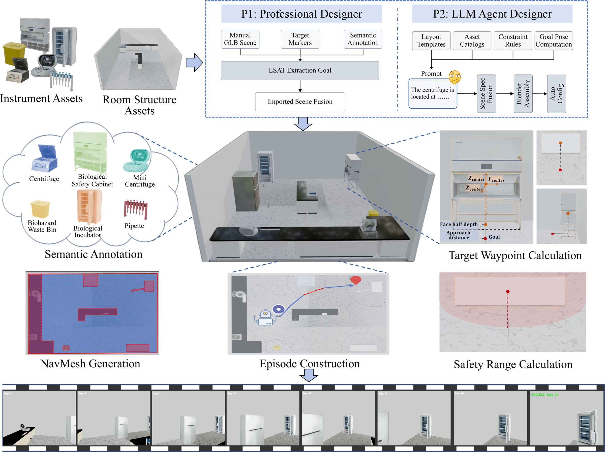

Complete BioVLN platform architecture:
- **P1 (left):** User-authored scene import (Path B) — manually built GLB scenes with `target_*` markers processed through LSAT goal extraction.
- **P2 (right):** Procedural generation (Path A) — instrument catalogs and layout templates drive automated scene construction.
- Both paths converge into a shared three-step pipeline (semantic annotation → navigation mesh → episode construction) and a six-method evaluation layer with safety metrics (MCR, VRT).

---

## Fig 2: Three-Zone Operational Envelope Model

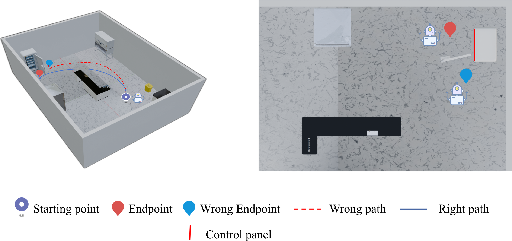

- **Left:** Schematic of operational-face goal navigation. The **blue solid path ending at a red point** represents correct navigation — the agent reaches the incubator's operational face. The **red dashed path ending at a blue point** is incorrect — reaching the incubator's body but not facing its operational surface.
- **Right:** Top-down view of the operational face, marked by a red solid line, showing the correct approach direction.

### Zone Variants

| Zone Model | Delta Parameter | Operational Envelope | Scene Envelope |
|:---:|:---:|:---:|:---:|
| 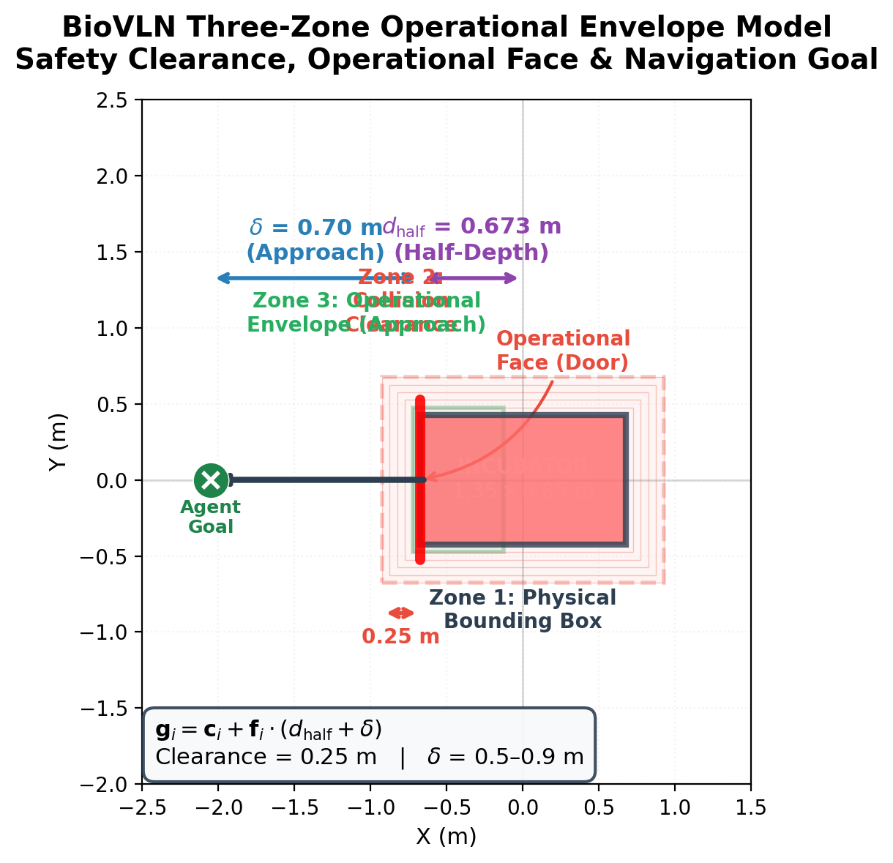 | 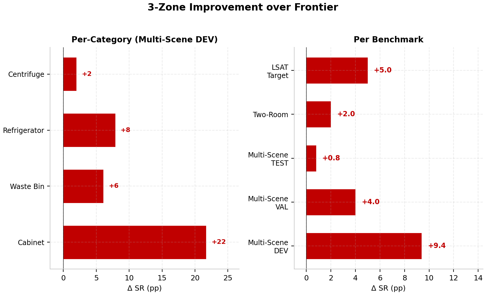 | 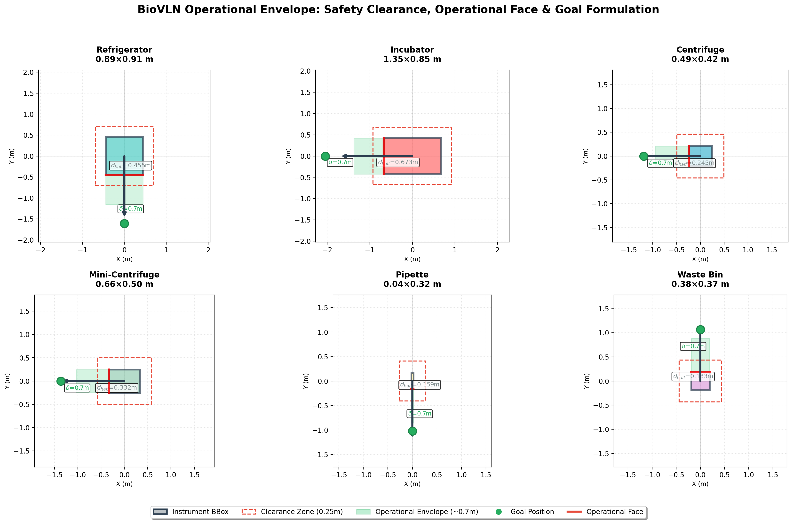 | 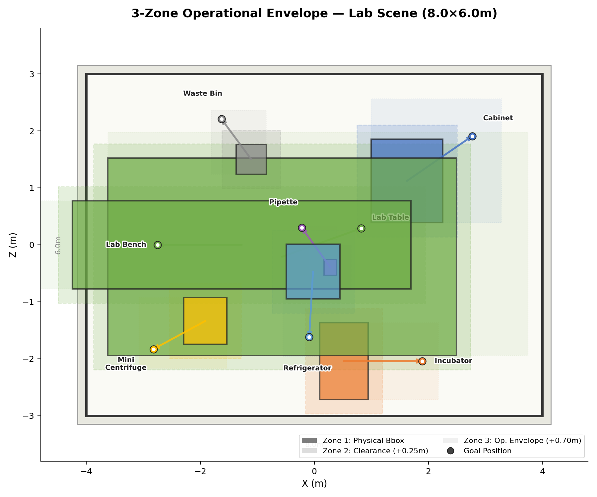 |

- **three_zone_model.png** — Three nested spatial zones: Zone 1 (physical bounding box), Zone 2 (0.25 m clearance buffer), Zone 3 (operational envelope).
- **three_zone_delta.png** — The delta parameter δ_i (0.5–0.9 m) defining Zone 3 depth per instrument category.
- **operational_envelope.png** — Generic operational envelope diagram with approach direction and success radius.
- **scene_operational_envelope.png** — Scene-level rendering with all instrument envelopes overlaid.

---

## Fig 3: Scene-Level Goal Positions

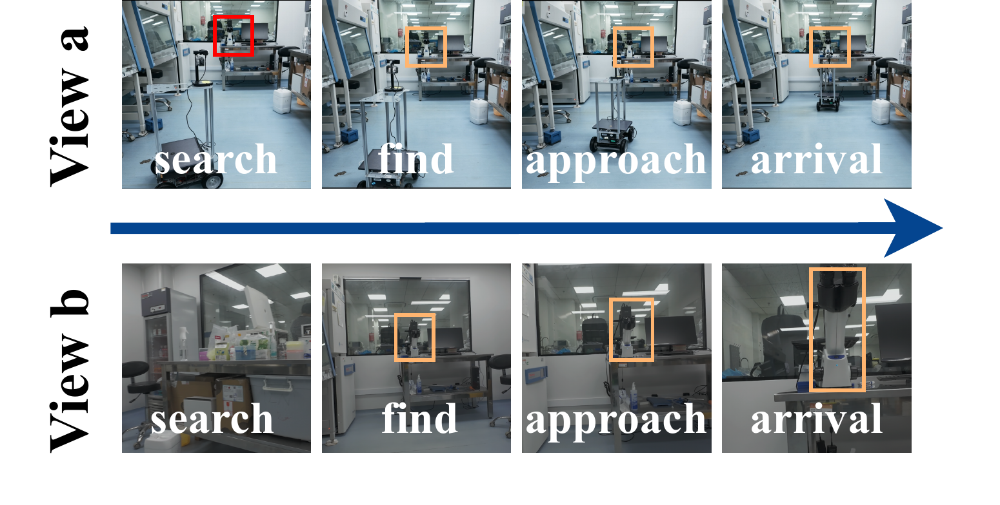

- **Left:** Oblique overview of a single-room laboratory scene showing operational-face goal endpoints for all instruments.
- **Right:** Top-down visualization with each instrument's goal position as a colored endpoint.

### Layout Templates

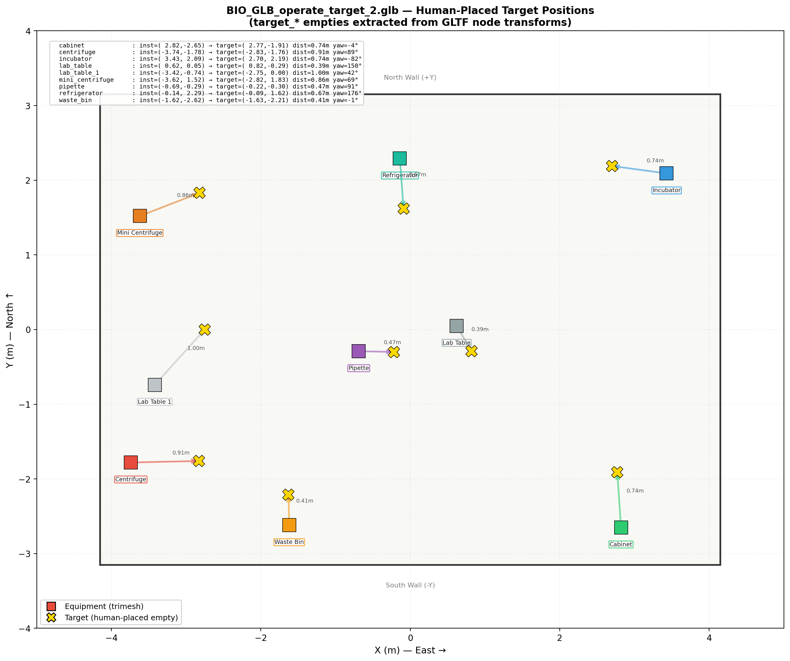

BioVLN defines four layout templates: single-room (8×6 m, 39 scenes), two-room (6×5 m + 3.5×3.5 m, 8 scenes), suite, and open-plan (future expansion).

---

## Fig 4: Safety Boundary Visualization

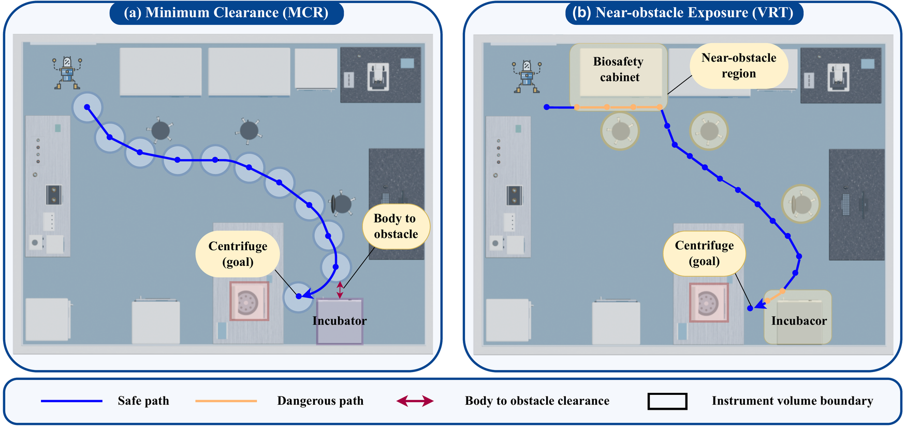

Top-down view of a single-room laboratory scene showing instrument safety boundaries. Each instrument is surrounded by a circular safety radius:
- **Red dashed path:** Navigation trajectory violating safety boundaries (enters instrument clearance zone)
- **Blue solid path:** Safe navigation trajectory maintaining clearance

This figure directly illustrates the **MCR** (Minimum Clearance Radius) and **VRT** (Violation Rate at Threshold) safety metrics.

---

## Per-Category Performance

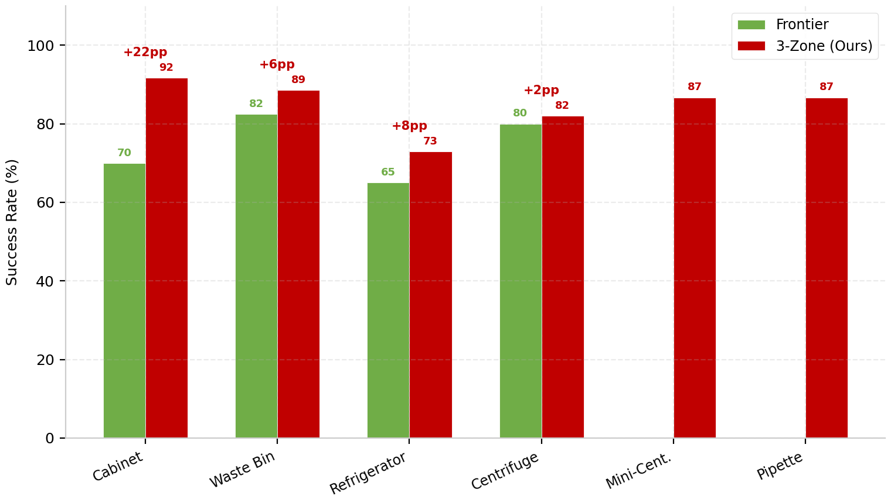

Bar chart showing **Frontier Exploration success rate by instrument category** across three datasets (MS-DEV, LSAT, Two-Room). Refrigerators are hardest (60–65%) due to corner placement; human-annotated LSAT goals are easier to reach (87.5%).

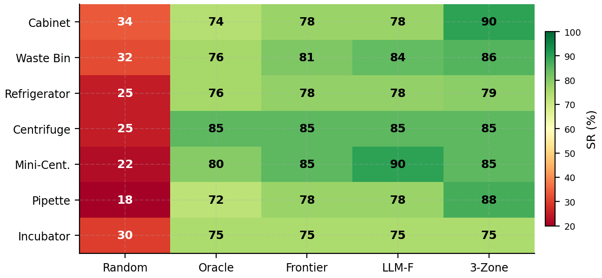

Heatmap of success rate across methods × instrument categories, highlighting VLFM's domain gap with laboratory instruments.

---

## Method Comparison

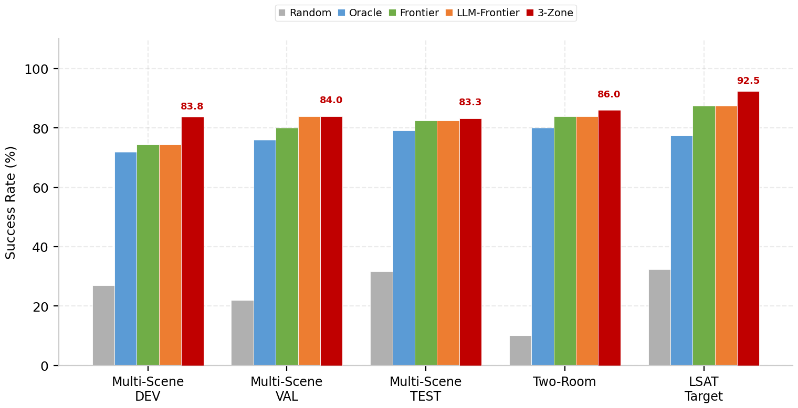

Overall success rate comparison across all 6 methods on Multi-Scene DEV:
- **Random:** 26.9% (lower bound)
- **Oracle:** 71.9% (empirical upper bound)
- **Frontier Exploration:** 74.4% (geometric coverage beats privileged geodesic knowledge)
- **LLM-Frontier:** 74.4% (no gain from semantic priors in non-zoned layouts)
- **3-Zone Oracle:** 83.8% (highest; multi-point zone-aware sampling)
- **VLFM:** 19.4% (surface texture sparsity limits VLM recognition)

---

## Difficulty Analysis

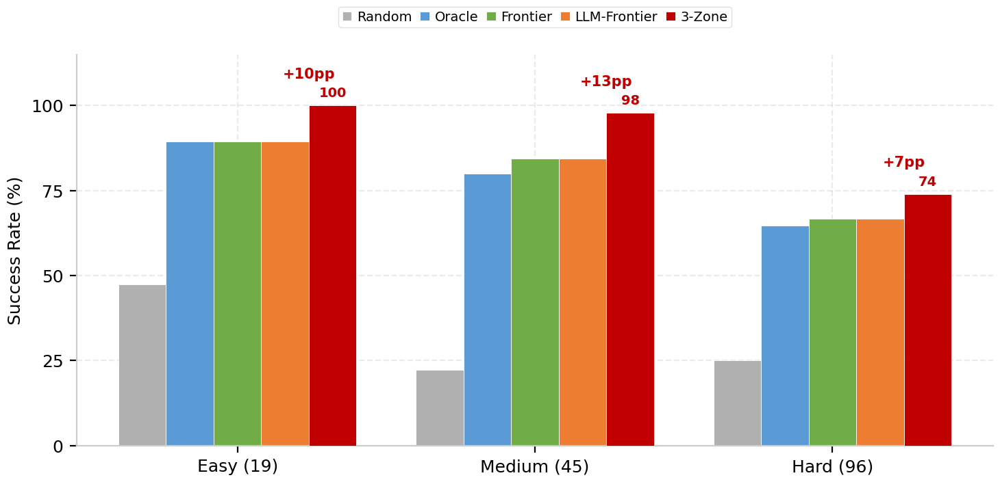

Success rate stratified by geodesic difficulty tier:
- **Easy** (<3.0 m): 89.5–100%
- **Medium** (3.0–6.0 m): 73.7–97.8%
- **Hard** (>6.0 m): 66.7–82.3%

Frontier Exploration and 3-Zone Oracle on Multi-Scene splits. Geodesic distance is the primary source of navigation difficulty in single-room layouts.

---

## Failure Analysis

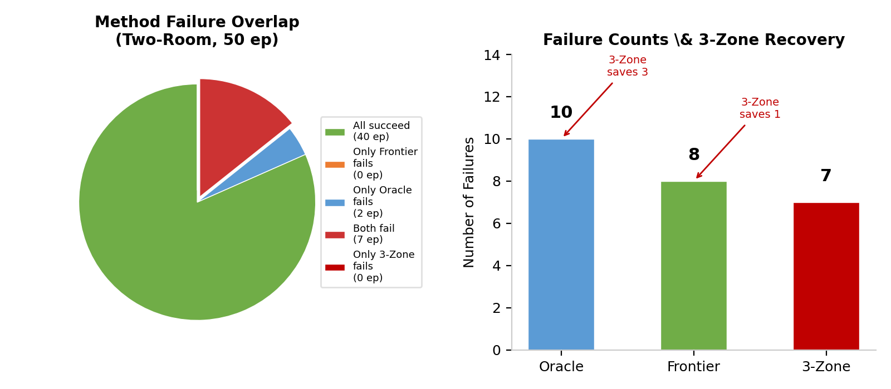

VLFM failure modes categorized by root cause: surface texture sparsity, VLM recognition error, navigation timeout, and collision. **Key finding:** GPT-4o has 100% conceptual knowledge of all instruments (text control) but only 13.3% recognition from rendered frames (4/30 viewpoints correct).

---

## Trajectory Visualizations

### LSAT Target Scene

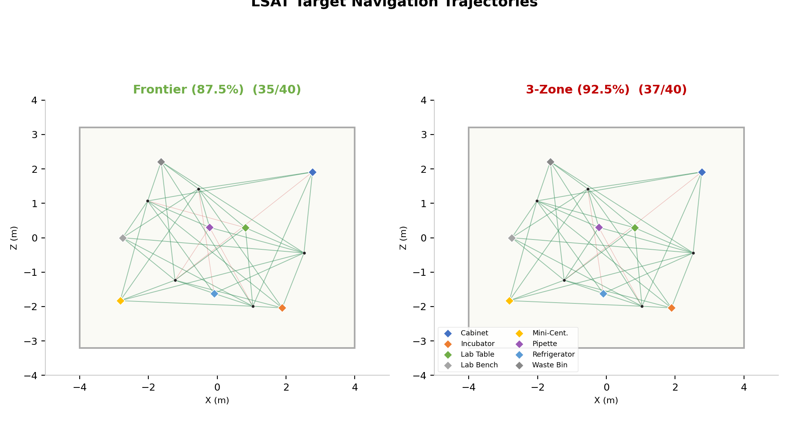

Top-down trajectory overlay on the LSAT Target scene (8 instruments, 40 episodes). Frontier Exploration paths with color-coded success/failure outcomes.

### Two-Room Benchmark

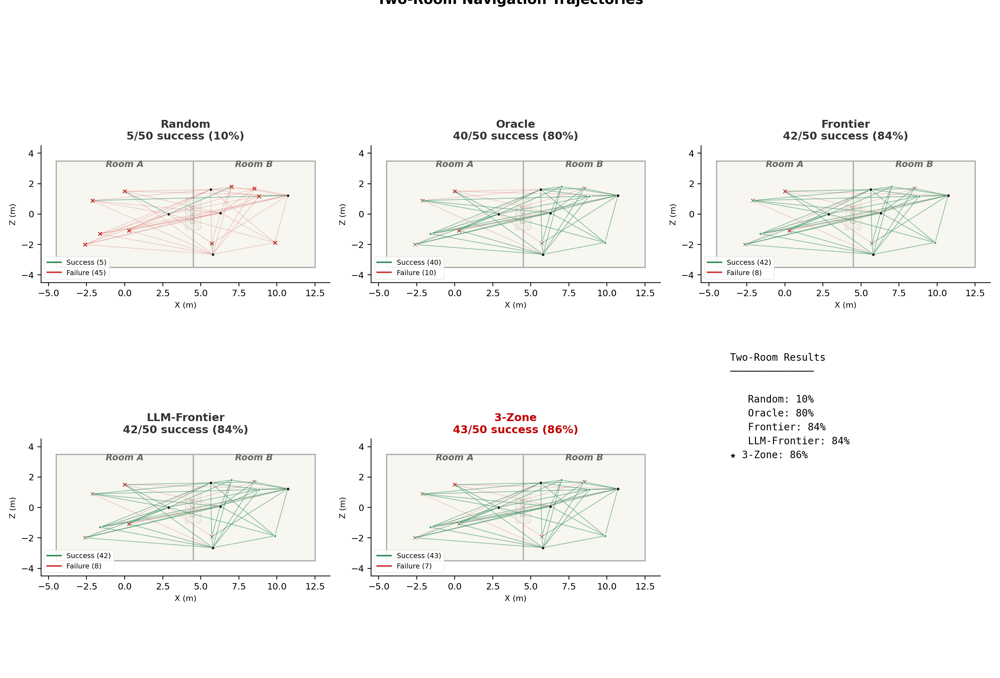

Corresponding visualization for the Two-Room benchmark (10 instruments, 50 episodes), highlighting cross-room navigation paths through the 1.5 m central corridor.

---

## Pipeline Architecture Detail

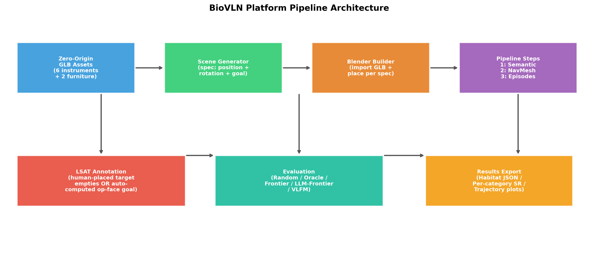

Detailed block diagram: Path A (procedural generation), Path B (user-authored import), and the shared three-step pipeline (semantic annotation → navigation mesh → episode construction).

---

## File Index

| File | Paper Location | Content |
|------|---------------|---------|
| `fig0.png` | Fig. 7 (Safety Analysis) | Safety boundary visualization |
| `fig1.png` | Fig. 2 (Problem Formulation) | Three-zone operational envelope model |
| `fig3.png` | Fig. 5 (Scene Generation) | Scene-level goal positions |
| `fig4.png` | Fig. 1 (Platform Architecture) | Complete platform architecture |
| `three_zone_model.png` | Fig. 2 | Zone 1/2/3 spatial model |
| `three_zone_delta.png` | Fig. 2 detail | δ_i parameter visualization |
| `operational_envelope.png` | Fig. 2 | Operational envelope diagram |
| `scene_operational_envelope.png` | Fig. 5 | Scene-level envelope overlay |
| `per_category_breakdown.png` | Table 7 | Per-instrument SR bar chart |
| `category_heatmap.png` | Table 7 | Method × category heatmap |
| `paper_comparison_chart.png` | Table 5 summary | 6-method SR comparison |
| `difficulty_breakdown.png` | Section 5.2 | Difficulty-tier analysis |
| `failure_analysis.png` | Section 5.5 | VLFM failure mode breakdown |
| `pipeline_architecture.png` | Fig. 1 detail | Pipeline block diagram |
| `scene_layout.png` | Fig. 5 | Layout template comparison |
| `lsat_trajectories.png` | Appendix | LSAT trajectory overlay |
| `two_room_trajectories.png` | Appendix | Two-Room trajectory overlay |
